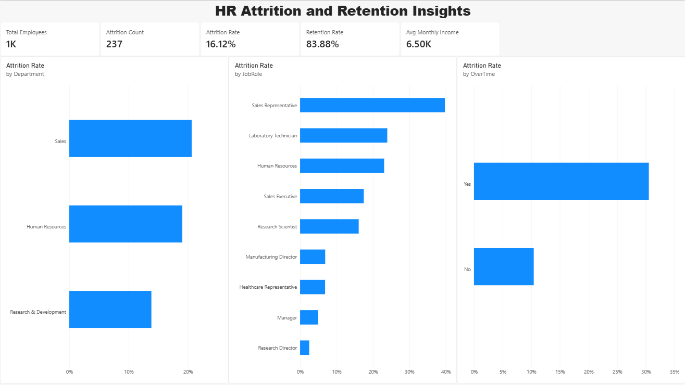
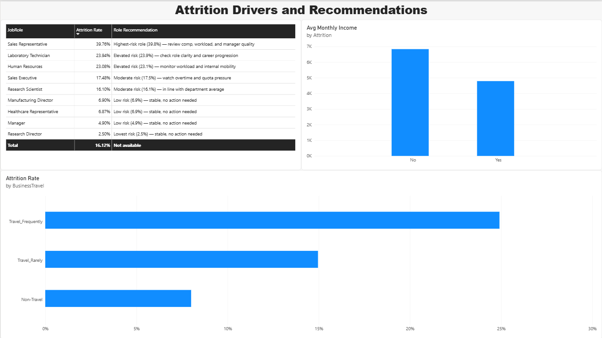
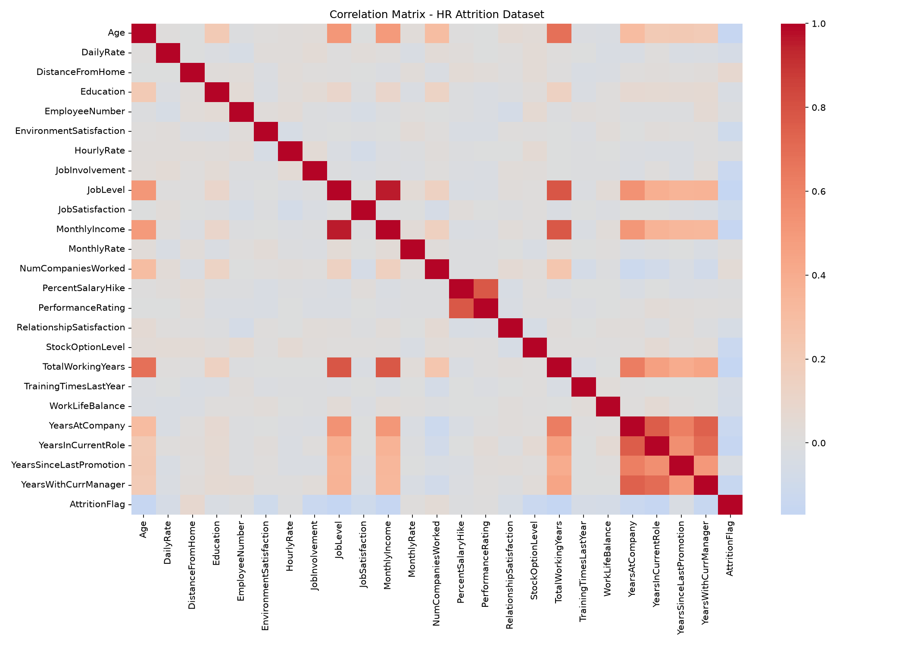

# HR Analytics Dashboard — Attrition & Retention

Week 3 project for the **Syntecxhub Data Analysis Internship**. An HR analytics dashboard analyzing employee attrition drivers, built from real (IBM-schema) employee data, with a Python-driven correlation analysis feeding a two-page Power BI dashboard.




## Objective

Analyze an employee dataset (salary, department, tenure, satisfaction) to identify patterns in attrition, run a correlation analysis to find the key drivers, compare attrition across departments and roles, and present it as a KPI-driven dashboard for HR decision-making.

## Dataset

- **Source:** IBM HR Analytics Employee Attrition dataset (Kaggle, IBM schema)
- **Size:** 1,480 raw rows × 38 columns → 1,470 rows × 35 columns after cleaning
- **Fields:** Age, Department, JobRole, MonthlyIncome, OverTime, JobSatisfaction, WorkLifeBalance, BusinessTravel, YearsAtCompany, Attrition, and more
- Raw file included at `data/Cleaned_HR_Data_Analysis.csv`

## Tools Used

- **Python (pandas, seaborn, matplotlib)** — data cleaning and correlation analysis
- **Power BI Desktop** — data modeling and interactive dashboard
- **DAX** — KPI measures and a role-level recommendation measure

## Data Cleaning

- **Dropped 10 duplicate `EmpID` rows**, keeping the first occurrence.
- **Filled 57 nulls in `YearsWithCurrManager` with 0** — verified these rows had a median `YearsAtCompany` of 1 and `YearsInCurrentRole` of 0, confirming they were new hires / new-to-role employees rather than missing data.
- **Fixed an inconsistent category label**: `BusinessTravel` contained both `"Travel_Rarely"` and `"TravelRarely"` (7 rows) — merged into one category, which also corrected a misleadingly low 0% attrition rate the split had produced.
- **Dropped 3 constant columns** (`EmployeeCount`, `StandardHours`, `Over18`) — zero variance, no analytical value.

1,470 clean employee records remained after cleaning.

## Analysis Methodology

- **Correlation analysis**: numeric features correlated against an `AttritionFlag` (0/1), visualized as a heatmap, to surface which factors move with attrition.
- **Categorical driver comparison**: attrition rate grouped by `OverTime`, `JobRole`, `Department`, `BusinessTravel`, and `MaritalStatus` to find the sharpest splits — these mattered more than the numeric correlations alone.
- Findings were translated into a per-role recommendation (DAX `SWITCH` measure) for the dashboard, rather than a generic "reduce attrition" statement.



## Dashboard

**1. Overview** — KPI cards (Total Employees, Attrition Count, Attrition Rate, Retention Rate, Avg Monthly Income), plus attrition rate by Department, by JobRole, and by OverTime.

**2. Drivers & Recommendations** — a JobRole table with attrition rate and a targeted recommendation per role, average monthly income by attrition status, and attrition rate by business travel frequency.

## Key Insights

- **Overall attrition rate: 16.12%** (237 of 1,470 employees) — a realistic baseline, not an inflated or flat figure.
- **OverTime is the sharpest driver**: employees working overtime attrite at **30.5%** vs. **10.4%** for those who don't — roughly 3x.
- **JobRole has the widest spread**: Sales Representative attrites at **39.8%**, while Research Director sits at just **2.5%** — the highest-risk role bleeds people at 16x the rate of the lowest.
- **Compensation matters**: employees who left averaged **$4,813/month** vs. **$6,829/month** for those who stayed.
- **Frequent travel roughly triples attrition risk**: 24.9% (Travel_Frequently) vs. 8.0% (Non-Travel).

## Repository Structure

```
Syntecxhub_HR_Analytics_Dashboard/
├── hr_attrition_analysis.py
├── Syntecxhub_HR_Analytics_Dashboard.pbix
├── HR_Analytics_Dashboard_Exported.pdf
├── data/
│   ├── Cleaned_HR_Data_Analysis.csv
│   └── hr_attrition_cleaned.csv
├── screenshots/
│   ├── overview.png
│   ├── drivers.png
│   └── correlation_heatmap.png
└── README.md
```

## About

Built as part of the [Syntecxhub](https://www.syntecxhub.com) Data Analysis Internship Program — Week 3.
